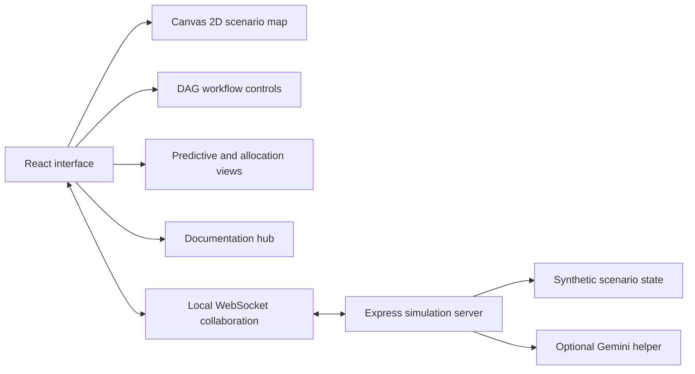

# OSIRIS System Architecture



## Trust boundary

```text
PUBLIC / LOCAL DEMO
  Browser UI, Express server, WebSocket collaboration,
  synthetic scenario data, optional Gemini requests

NOT CONNECTED
  CAL FIRE CAD, USFS AFF / IRWIN, FAA operational feeds,
  PagerDuty, production PostgreSQL, Kafka, or agency storage
```

## Render loop

```text
scenario state -> geodetic projection -> Canvas draw -> pointer hit test -> dossier
```

Canvas rendering reduces DOM-node pressure, but performance varies by device and browser. No fixed FPS or latency guarantee is made without a reproducible benchmark attached to the cited commit.

## DAG execution model

```text
ingest demo records -> validate -> transform independent branches -> load demo mart
```

The UI models dependencies, retries, notes, throttling, and exported configuration. Durations and resource measurements shown in the interface are scenario values, not production telemetry.
