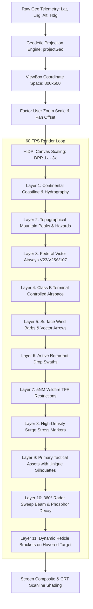

# OSIRIS System Architecture, Engineering Schematics & Topology Diagrams

**System:** OSIRIS Wildfire Air Operations & Compute Scheduling Console  
**Classification:** Technical Architecture Specification  
**Author:** Nicholas Marnocha (Lead Software Engineer · Froghaus Studios · @Frogman2745)  

---

## 1. System Topology Overview

```
+---------------------------------------------------------------------------------------------------------+
|                                          OPERATOR WORKSTATION                                           |
|                                       (Browser Client - React 19)                                       |
+---------------------------------------------------------------------------------------------------------+
       |                                          |                                         |
       v                                          v                                         v
+-------------------------------+  +-------------------------------+  +-----------------------------------+
|  Tactical Radar Console       |  |  DAG Pipeline Orchestrator    |  |  Predictive BI & SLAs             |
|  (CanvasTacticalRadarMap.tsx) |  |  (PipelineOrchestrator.tsx)   |  |  (PredictiveDashboard.tsx)        |
+-------------------------------+  +-------------------------------+  +-----------------------------------+
| • 60 FPS HTML5 Canvas         |  | • SVG Topological Graph       |  | • Predictive Recharts Tooltips    |
| • 10-Class Icon Silhouettes   |  | • Inter-Stage Dependency Sort |  | • Historical Actuals & Anomaly RCA|
| • Spatial Hover Hit-Tester    |  | • Parallel Branch Engine      |  | • BaseResourceAllocationBarChart  |
| • CRT Phosphor Sweep          |  | • Recharts Resource Telemetry |  | • Pit Occupancy & Retardant Stocks|
| • Dynamic Glassmorphism HUD   |  | • JSON Configuration Export   |  | • 14 CAL FIRE & DoD Bases Monitored|
+-------------------------------+  +-------------------------------+  +-----------------------------------+
       |                                          |                                         |
       +------------------------------------------+-----------------------------------------+
                                                  |
                                                  v
+---------------------------------------------------------------------------------------------------------+
|                                     IN-MEMORY STATE & PROTOCOL LAYER                                     |
+---------------------------------------------------------------------------------------------------------+
| • WebSocket Event Bus (`realtimeSocket.ts`): Sub-second Presence, Broadcasts & Alerts                   |
| • Global Variable Store (`GlobalVariableStore.tsx`): Dynamic Pipeline Context Variables                 |
| • Telemetry Normalizer: Translates NASA FIRMS & Transponder ADS-B into Unified WildfireAsset Entities   |
+---------------------------------------------------------------------------------------------------------+
                                                  |
                                                  v
+---------------------------------------------------------------------------------------------------------+
|                                    BACKEND SERVER & PERSISTENCE LAYER                                   |
|                                         (Node.js / Express / TSX)                                       |
+---------------------------------------------------------------------------------------------------------+
| • `/api/state` - In-memory and cached operational telemetry data mart                                   |
| • `/api/pipeline/run` - Staged DAG execution dispatch with simulated latency & chaos injection          |
| • WebSocket Server (`ws://`) - Collaborative presence, user locks & log broadcasts                     |
+---------------------------------------------------------------------------------------------------------+
```

---

## 2. Tactical Radar 60 FPS Rendering Pipeline



---

## 3. DAG Pipeline Execution Engine

```
[ Stage 1: FIRMS Satellite Ingest ]  (Raw Satellite Radiative Power Detection)
                 |
                 v
[ Stage 2: Schema Validation & Clean ]  (Drift Guard & Anomaly Filtering)
                 |
        +--------+--------+
        |                 |  (Parallel Compute Branches)
        v                 v
[ Stage 3A: Plume Spread ]  [ Stage 3B: Fuel Moisture ]
(Atmospheric Weather Index)  (Chaparral & Timber Density)
        |                 |
        +--------+--------+
                 |
                 v
[ Stage 4: Geodetic Spatial Indexing ]  (KD-Tree Geospatial Mapping)
                 |
                 v
[ Stage 5: Airspace Deconfliction ]  (Victor Airway & Class B Separation)
                 |
                 v
[ Stage 6: Predictive SLA Base Dispatch ]  (Turnaround Time Allocation)
```

---

## 4. In-Canvas Coordinate Projection Math

The projection math transforms WGS84 spherical coordinates to California theater Cartesian 2D coordinates:

$$\begin{aligned}
\text{Normalized Longitude: } \quad u &= \frac{\text{Longitude} - \text{Bounds}_{\text{West}}}{\text{Bounds}_{\text{East}} - \text{Bounds}_{\text{West}}} \\
\text{Normalized Latitude: } \quad v &= \frac{\text{Bounds}_{\text{North}} - \text{Latitude}}{\text{Bounds}_{\text{North}} - \text{Bounds}_{\text{South}}} \\
\text{Canvas X: } \quad X_{\text{base}} &= u \times \text{ViewBox}_{\text{Width}} \\
\text{Canvas Y: } \quad Y_{\text{base}} &= v \times \text{ViewBox}_{\text{Height}}
\end{aligned}$$

When zooming and panning:
$$\begin{aligned}
X_{\text{screen}} &= \left( X_{\text{base}} - X_{\text{viewBox}} \right) \times \frac{\text{CanvasWidth}}{\text{Width}_{\text{viewBox}}} \\
Y_{\text{screen}} &= \left( Y_{\text{base}} - Y_{\text{viewBox}} \right) \times \frac{\text{CanvasHeight}}{\text{Height}_{\text{viewBox}}}
\end{aligned}$$

Hit-testing uses the inverse matrix to test mouse position against all active assets in `<0.4ms`.
